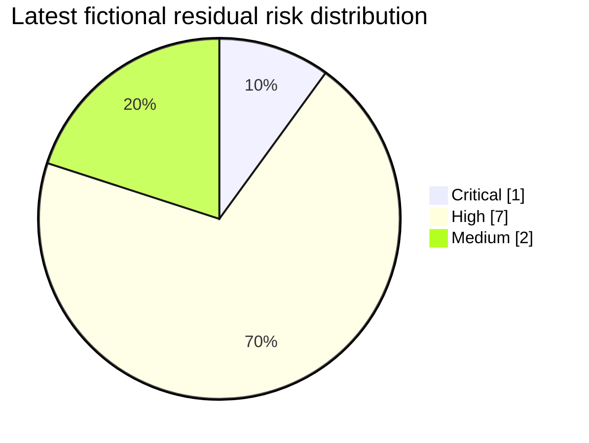

# ISMS Portfolio Dashboard — Fictional baseline to follow-up

> **SIMULATED TRAINING CASE • VERSION 0.4 • NOT ISO/IEC 27001 CERTIFIED**  
> Selene Payments Ltd, its staff, assets, observations, tests, audit grades and management proposals are invented. Numbers reflect qualitative, selected samples; **they are not a compliance percentage, certification forecast or actual operational control effectiveness.**  
> Scenario dates: baseline **2026-11-05**; hypothetical audit **2026-11-19**; modeled technical follow-up **2026-12-18** and management review **2026-12-20**. The latter dates are fictional future events, not work already performed.

## Executive summary

| Measure | Baseline v0.1 | Latest fictional follow-up v0.3 | Meaning |
| :-- | --: | --: | :-- |
| **Critical residual risks** | **2** | **1** | One scenario improves through scoped MFA evidence, cloud configuration remains Critical |
| **High residual risks** | 6 | 7 | Improved Critical risk becomes High; **High still requires action** |
| **Medium residual risks** | 2 | 2 | No change |
| **Provisional Annex A control decisions** | 23 originally selected for focus | **93/93 reviewed** | **91 provisionally necessary, 2 proposed exclusions** |
| **Necessary Annex A controls not verified** | Unassessed baseline coverage | **70** | These are *unknown*, not passing controls |
| **Indicative audit findings** | No prior audit | **9** of 10 sampled checks | Six Major-style and three Minor-style teaching labels |
| **Corrective actions formally closed** | No completed audit process | **0 / 9** | Evidence progression is not sign-off |
| **Actual management authorizations** | None | **0 / 7** | Seven role-play proposals only |

Risk distribution across the ten fictional residual-risk scenarios:



**Management interpretation:** This fictional ISMS has **not demonstrated conformity or a functioning approved management system**. The provisional SoA contains necessary decisions and pending evidence, not evidence that 91 controls operate. No independent audit occurred, no CAPA is closed and no authorized management review has been held.

## Risk comparison — all ten scenarios

| Risk | Baseline residual | Latest provisional residual | Score change | Evidence reason |
| :-- | --: | --: | --: | :-- |
| ISMS-R01 — privileged account takeover | 20 Critical | **10 High** | −10 | P3-E01: synthetic 7/7 privileged human MFA coverage; impact remains 5 |
| ISMS-R02 — information ownership gaps | 16 High | 16 High | 0 | Ownership/classification not completed |
| ISMS-R03 — critical vulnerability exploitation | 16 High | 16 High | 0 | Six overdue critical issues remain |
| ISMS-R04 — incomplete event logging | 12 High | 12 High | 0 | Five of nine important feeds covered |
| ISMS-R05 — recovery failure | 15 High | 15 High | 0 | End-to-end restoration not demonstrated |
| ISMS-R06 — delayed incident escalation | 12 High | 12 High | 0 | Playbook not approved or tested |
| ISMS-R07 — lost employee laptop | 6 Medium | 6 Medium | 0 | Original scoped encryption evidence retained |
| ISMS-R08 — insecure release | 16 High | 16 High | 0 | Release gates not verified |
| ISMS-R09 — employee awareness | 9 Medium | 9 Medium | 0 | Attendance rose, but effectiveness not shown |
| ISMS-R10 — cloud misconfiguration | **20 Critical** | **20 Critical** | 0 | Cloud configuration baseline and drift monitoring unresolved |

These are **residual** scores, not inherent scores. The original `data/risk_register.csv` is preserved. Details: [risk evolution](data/risk_evolution.csv) · [original scores](../data/risk_register.csv) · [fictional follow-up](../phase3/data/risk_follow_up.csv).

## Statement of Applicability — selection ≠ implementation

| Status in separate provisional v0.2 register | Count |
| :-- | --: |
| Necessary — existing **Gap** observation | 11 |
| Necessary — existing **Partial** observation | 10 |
| Necessary — implementation **Not verified** | **70** |
| Proposed exclusions awaiting authorization (A.7.6, A.8.30) | 2 |
| **Total Annex A references** | **93** |

The **24 selected Clauses 4–10 checkpoints** separately contain **14 Gap, 9 Partial and 1 Not assessed**; they are not a full conformity audit. See [SoA review](../phase2/data/soa_applicability_review.csv) and [requirements review](../data/clauses_gap_assessment.csv).

## Audit and corrective-action trail

| Audit sample state | Count | Meaning |
| :-- | --: | :-- |
| Indicative Major-style findings | 6 | Training severity, not a qualified audit opinion |
| Indicative Minor-style findings | 3 | Training severity, not a qualified audit opinion |
| Scoped positive observation | 1 | Fictional 15/15 employee-device encryption sample |
| Corrective actions remaining open | **9** | No independent effectiveness closure |
| Evidence follow-ups reviewed | 2 | One scope-limited technical improvement; one attendance-only improvement |

[Audit-to-action crosswalk](data/audit_action_crosswalk.csv) · [full sample log](../phase3/data/audit_samples.csv) · [CAPA register](../phase3/data/corrective_actions.csv)

## Operational indicators (fictional)

| Measure | Baseline | Follow-up | Outstanding gap |
| :-- | --: | --: | :-- |
| Privileged human MFA | 4/7 | **7/7** | Independent recurring validation and audit closure |
| Training attendance | 16/30 | **30/30** | Report/behavioral effectiveness untested |
| Priority log sources | 5/9 | **5/9** | Four source classes still absent |
| Overdue critical vulnerabilities | 6 | **6** | No documented remediations/exceptions |
| Complete recovery exercises | 0 | **0** | Business-endorsed recovery test missing |
| Approved internal audit programmes | 0 | **0** | Desk rehearsal is not operating Clause 9.2 audit |

[All dashboard indicators and data provenance](data/dashboard_indicators.csv) · [KPI snapshot](../phase3/data/kpi_snapshot.csv)

## Decision priorities for an ISMS owner

1. **Treat ISMS-R10 Critical** by establishing cloud hardening and independently examining configuration drift.
2. Close or explicitly escalate the overdue vulnerability backlog and perform a full payment-workload restoration exercise.
3. Create a genuine ISMS sponsor, risk acceptance roles, internal audit programme and management review cadence.
4. Independently check privileged access and training effectiveness before closing either corrective action.
5. Verify assumptions before proposing approval of exclusions A.7.6 and A.8.30; validate 70 necessary but currently unverified controls.

**Release interpretation:** This is a demonstrable, independently authored **simulation of GRC documentation workflows**, not verified ISO compliance. The project is appropriate to present as a portfolio exercise once its owner reviews the documents; no fake certificates, approvals or real audit work are claimed.

## Reproduce and inspect

```bash
python scripts/validate_project.py
python scripts/validate_phase2.py
python scripts/validate_phase3.py
python scripts/validate_portfolio.py
python scripts/validate_workbook.py
python scripts/validate_manifest.py
python -m unittest discover -s tests -v
```

Data sources are the versioned CSV files. The two existing Excel workbooks are **v0.1 and v0.2 snapshots**, not live Phase 4 dashboards. This GitHub-readable page is the integrated v0.4 dashboard.
